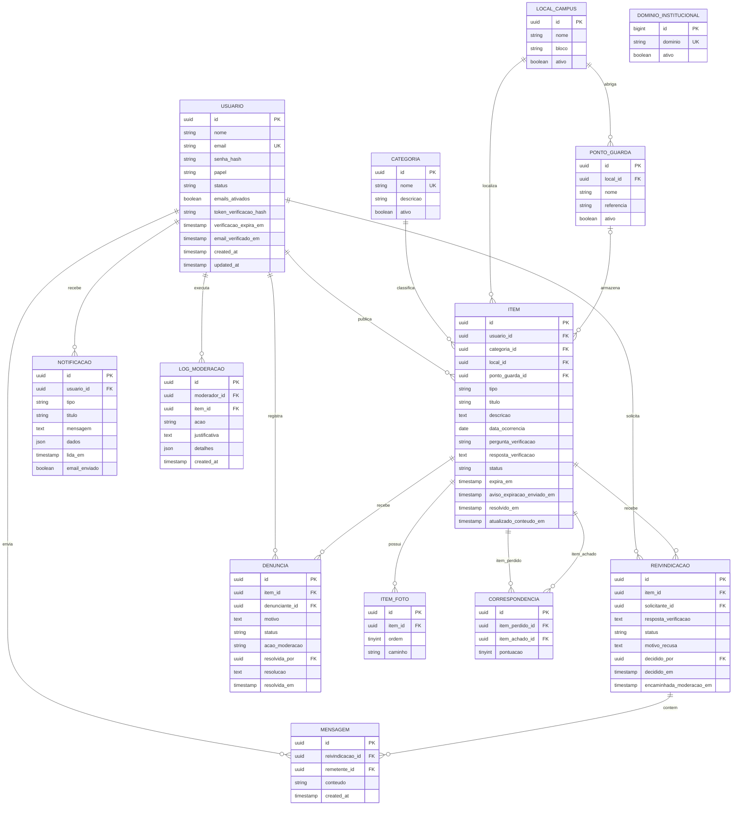

# Diagrama Entidade-Relacionamento (DER)

O esquema abaixo corresponde às migrações do MVP em `backend/database/migrations`. Os identificadores das entidades principais são UUIDs; `dominios_institucionais` usa chave numérica autoincremental por ser uma tabela de configuração.

## Restrições e integridade

A tabela técnica `personal_access_tokens`, criada para o Laravel Sanctum, armazena tokens Bearer com expiração. Ela não faz parte das entidades de negócio do diagrama. As tabelas de cache, sessão e fila não são necessárias no ambiente local (drivers em arquivo/síncrono) e não são criadas pela migração do domínio.

- **Usuário → item:** o publicador é opcional apenas para aceitar cadastro administrativo de itens recebidos presencialmente. Se a conta for excluída no futuro, o anúncio histórico pode permanecer sem referência ao usuário.
- **Fotos:** no máximo três fotos por publicação, em ordem de 1 a 3; a API verifica formatos JPG/JPEG, PNG e WEBP e limite de 5 MB por arquivo. `UNIQUE (item_id, ordem)` evita repetir a posição.
- **Itens achados:** a API exige no mínimo uma foto e uma pergunta/resposta de verificação. A resposta esperada é criptografada na aplicação e tanto a pergunta quanto a resposta são excluídas das respostas públicas.
- **Categorias sensíveis:** anúncios achados de Documentos, Cartões e Eletrônicos exigem um perfil de moderação/administrador e ponto de guarda associado.
- **Reivindicações ativas:** MySQL não possui índices únicos parciais como os descritos originalmente. A migração cria colunas geradas `solicitante_ativo` e `item_aprovado`: a primeira possibilita apenas uma reivindicação pendente/aprovada de cada pessoa por item; a segunda garante só uma reivindicação aprovada por item.
- **Denúncias:** `UNIQUE (item_id, denunciante_id)` bloqueia uma segunda denúncia do mesmo usuário sobre o mesmo anúncio. A ação da moderação fica registrada para contar decisões procedentes e suspender automaticamente contas ao atingir três ocorrências confirmadas.
- **Integridade referencial:** chaves estrangeiras protegem categorias, locais, pontos de guarda, fotos, reivindicações, mensagens, notificações, denúncias e correspondências. Exclusões de categorias/locais referenciados são restritas; fotos e registros dependentes têm exclusão em cascata quando apropriado.
- **Busca:** índice composto em status, tipo, categoria, local e data de criação. O MySQL usa um índice FULLTEXT para a busca textual por título/descrição; drivers de desenvolvimento sem esse recurso usam `LIKE`.
- **Estados principais do item:** `ABERTO`, `PONTO_GUARDA`, `RESOLVIDO`, `EXPIRADO`, `OCULTO`.
- **Estados principais da reivindicação:** `PENDENTE`, `APROVADA`, `RECUSADA`, `CANCELADA`, `DEVOLVIDA`.
- **Histórico:** itens resolvidos, expirados e ocultos continuam armazenados e não aparecem na busca pública. As decisões relevantes são registradas em `logs_moderacao`.
